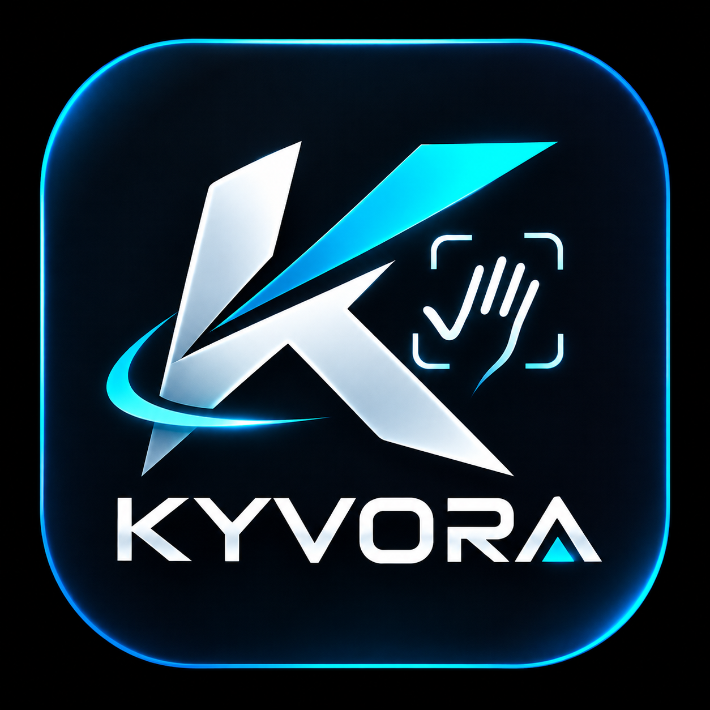
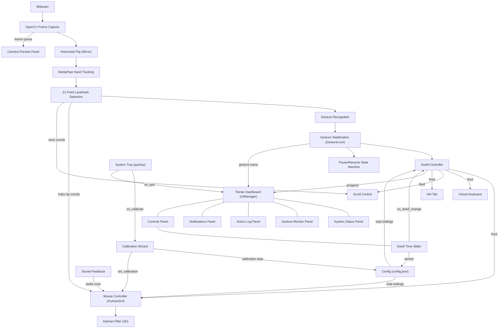

<p align="center">
  
</p>

<h1 align="center">KYVORA — Gesture Control System</h1>

<p align="center">
  Control your computer using hand gestures through a standard webcam.<br>
  Built with MediaPipe, OpenCV, and Python.
</p>

<p align="center">
  
  
  
  
</p>

---

## Overview

KYVORA is a real-time gesture-controlled desktop application that replaces traditional mouse and keyboard input with hand gestures captured through a webcam. It uses Google's MediaPipe hand tracking to detect 21 hand landmarks and maps specific hand poses to computer actions such as cursor movement, clicking, scrolling, drag-and-drop, window switching, and on-screen keyboard control.

The application features a modular desktop dashboard with detachable panels, a calibration wizard, Kalman-filtered cursor smoothing, adjustable gesture activation timing, a pause/resume system, audio feedback, and multi-language support (English and Arabic with RTL layout).

---

## Key Features

| Category | Feature |
|---|---|
| **Hand Tracking** | Real-time 21-point hand landmark detection via MediaPipe |
| **Cursor Control** | Index finger tracking with Kalman filter smoothing |
| **Mouse Actions** | Left click, right click, scroll, drag-and-drop (hold click) |
| **Keyboard & Window** | On-screen keyboard toggle, Alt+Tab window switching |
| **Pause / Resume** | Open Palm gesture or GUI button to pause and resume all controls |
| **Calibration** | 4-corner calibration wizard with median sampling for accuracy |
| **Dwell Time** | Adjustable gesture activation delay (0.3 s – 3.0 s) via GUI slider |
| **Modular GUI** | 6 detachable/dockable panels: Camera, Status, Gesture, Actions, Notifications, Controls |
| **Audio Feedback** | Sound cues for gesture confirmation, hold, release, and errors |
| **Safety** | PyAutoGUI failsafe — move cursor to top-left corner to stop |
| **System Tray** | Background tray icon with quick access to calibration and quit |
| **Multi-Language** | English and Arabic interface with native RTL layout |
| **Configuration** | JSON-based settings with runtime persistence |

---

## Supported Gestures

| # | Gesture | Hand Pose | Action | Activation |
|---|---|---|---|---|
| 1 | **Pointing** | Index finger extended, others closed | Move cursor | Instant |
| 2 | **Pinch** | Thumb tip touches index finger tip | Left click | Dwell |
| 3 | **V Sign** | Index + middle finger extended | Right click | Dwell |
| 4 | **Three Fingers** | Index + middle + ring extended | Toggle on-screen keyboard | Dwell |
| 5 | **Four Fingers** | Index + middle + ring + pinky extended | Scroll (move hand up/down) | Dwell |
| 6 | **Fist** | All fingers closed | Toggle camera window | Dwell |
| 7 | **Thumbs Up** | Thumb pointing up, all fingers closed | Hold left click (drag) | Dwell |
| 8 | **Wolf** | Index + pinky up, middle + ring touching thumb | Alt+Tab | Dwell |
| 9 | **Open Palm** | All five fingers extended | Pause / Resume | Independent (1.0 s) |

> **Note:** The Open Palm gesture uses an independent 1.0-second dwell timer with cooldown and neutral-state rearming. After toggling, you must return your hand to a neutral position (e.g., close fist or leave the frame) before toggling again. This prevents accidental rapid toggling.

---

## System Architecture



### Thread Architecture

KYVORA uses a two-thread architecture:

| Thread | Responsibility |
|---|---|
| **Main Thread** | Tkinter GUI (`UIManager.run()`) — event loop, panel rendering, user interaction |
| **Camera Thread** | Frame capture, hand tracking, gesture recognition, dwell timing, mouse/keyboard control |

The threads communicate through thread-safe queues:
- **`_frame_q`** — Camera frames sent to the GUI for the camera preview panel
- **`_q`** — State updates, gesture data, and notifications sent from the camera thread to the UI

---

## System Requirements

| Component | Requirement |
|---|---|
| **Python** | 3.10 or later |
| **Webcam** | Any USB or built-in webcam |
| **CPU** | Modern dual-core or better |
| **RAM** | 4 GB or more |
| **GPU** | Not required (CPU inference is used) |
| **OS** | Windows, macOS, or Linux |

---

## Python Dependencies

All dependencies are listed in `requirements.txt`:

| Package | Purpose |
|---|---|
| `mediapipe` | Hand landmark detection and tracking |
| `opencv-python` ≥ 4.8.0 | Webcam capture, frame processing, image drawing |
| `pyautogui` ≥ 0.9.54 | Mouse and keyboard control |
| `numpy` ≥ 1.24.0 | Kalman filter math and calibration statistics |
| `pystray` ≥ 0.19.0 | System tray icon |
| `Pillow` ≥ 10.0.0 | Image handling for GUI and tray icon |

> **Note:** Tkinter is included with Python on Windows and macOS. On Linux, you may need to install it separately (e.g., `sudo apt install python3-tk`).

---

## Installation and Setup

### 1. Clone the Repository

```bash
git clone https://github.com/your-username/KYVORA.git
cd KYVORA
```

### 2. Create a Virtual Environment

**Windows (PowerShell):**

```powershell
python -m venv .venv
.\.venv\Scripts\Activate.ps1
```

**macOS / Linux:**

```bash
python3 -m venv .venv
source .venv/bin/activate
```

### 3. Install Dependencies

```bash
python -m pip install -r requirements.txt
```

### 4. Run KYVORA

```bash
python main.py
```

On first launch, you will be prompted to choose a language (English or Arabic) and whether the camera preview should be visible.

---

## Configuration

Settings are stored in `config.json` in the project directory. They can be edited manually or adjusted through the application GUI.

| Key | Default | Description |
|---|---|---|
| `cam_index` | `0` | Camera device index (0, 1, 2…) |
| `frame_w` | `640` | Camera capture width in pixels |
| `frame_h` | `480` | Camera capture height in pixels |
| `dwell_sec` | `1.5` | Gesture activation delay in seconds (0.3 – 3.0) |
| `scroll_speed` | `2` | Scroll speed multiplier |
| `dominant_hand` | `"right"` | Dominant hand: `"right"` or `"left"` |
| `low_perf` | `false` | Reduce resolution for better FPS on slower hardware |
| `sound_enabled` | `true` | Enable or disable audio feedback |
| `kalman_process_noise` | `0.008` | Kalman filter process noise (lower = smoother cursor) |
| `kalman_measurement_noise` | `0.15` | Kalman filter measurement noise (higher = smoother cursor) |
| `pinch_threshold` | `0.28` | Pinch detection sensitivity (set automatically by calibration) |
| `language` | — | Interface language: `"en"` or `"ar"` |

---

## Safety

KYVORA uses the PyAutoGUI failsafe mechanism:

> **Move your mouse cursor to the top-left corner of the screen to immediately stop the program.**

This is a built-in safety feature that prevents loss of control. It cannot be disabled.

Additionally, the **Open Palm** pause gesture provides a hands-free way to instantly stop all gesture-based control without closing the application.

---

## Platform Notes

| Platform | Notes |
|---|---|
| **Windows** | Uses DirectShow for camera capture. Includes a hidden message-pump window for stable frame reading. |
| **macOS** | You must grant Accessibility permissions to your terminal or Python so the app can control the mouse. |
| **Linux** | Install Tkinter if missing: `sudo apt install python3-tk`. On-screen keyboard requires `onboard`, `florence`, or `xvkbd`. |

---

## Troubleshooting

| Problem | Solution |
|---|---|
| Camera does not open | Change `cam_index` in `config.json` (try `0`, `1`, or `2`) |
| Tracking is unstable | Run the calibration wizard from the GUI. Ensure good, even lighting. |
| FPS is low | Set `low_perf` to `true` in `config.json` |
| Gestures activate too quickly or slowly | Adjust the dwell time slider in the Controls panel (0.3 s – 3.0 s) |
| Cursor jitters or drifts | Adjust `kalman_process_noise` and `kalman_measurement_noise` in `config.json` |
| On-screen keyboard not found (Linux) | Install one of: `onboard`, `florence`, `xvkbd`, or `cellwriter` |

---

## Project Structure

```
KYVORA/
├── main.py              # Application entry point and camera loop
├── ui_manager.py        # Modular Tkinter dashboard with detachable panels
├── gesture.py           # Gesture recognition from 21 hand landmarks
├── hand_tracker.py      # MediaPipe hand tracking wrapper
├── mouse_ctrl.py        # Kalman-filtered mouse control via PyAutoGUI
├── kalman.py            # 2D Kalman filter implementation
├── dwell.py             # Dwell-time gesture activation controller
├── calibration.py       # 4-corner calibration wizard
├── vkeyboard.py         # Cross-platform on-screen keyboard launcher
├── config.py            # JSON-based configuration management
├── lang.py              # Multi-language string definitions (EN/AR)
├── sound.py             # Cross-platform audio feedback
├── tray.py              # System tray icon (pystray)
├── config.json          # User settings (auto-generated)
├── Logo.png             # KYVORA application logo
├── requirements.txt     # Python package dependencies
├── LICENSE              # MIT License
└── THIRD-PARTY-NOTICES.md
```

---

## License

This project is licensed under the [MIT License](LICENSE).

Copyright © 2026 Yosef Elsersy
